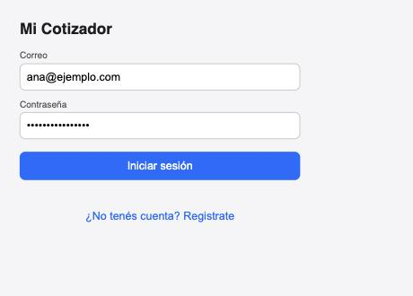
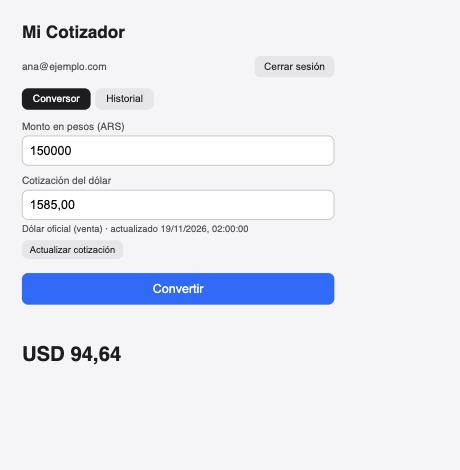
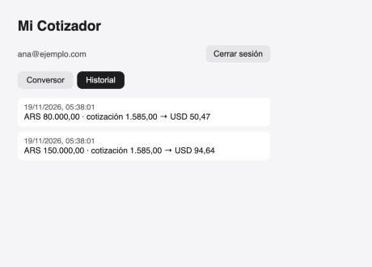
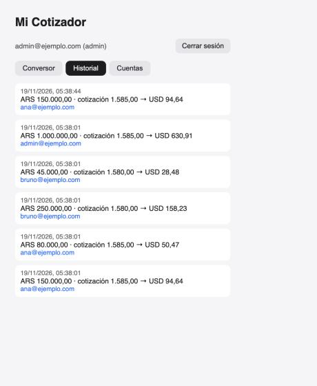
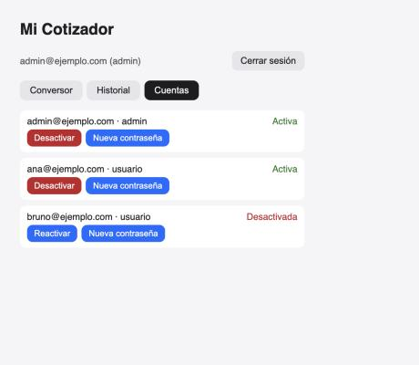

# Mi Cotizador

App de escritorio (macOS) hecha en Python para **convertir pesos a dólares**. Trae sola la cotización del dólar oficial, pide iniciar sesión, guarda cada conversión en una base de datos (PocketBase) y tiene un panel para administradores.

Construida paso a paso con Claude Code y [OpenSpec](https://github.com/Fission-AI/OpenSpec) para la Diplomatura en Gestión de Transformación Digital Asistida por IA Generativa (Módulo 4, clase 11).

## Capturas

Las capturas usan cuentas y datos de ejemplo.

| Inicio de sesión | Conversor con cotización automática |
|---|---|
|  |  |

| Historial de un usuario | Historial del admin (todos) |
|---|---|
|  |  |

**Panel de cuentas (solo admin):**



## Qué hace

- **Convierte** un monto en pesos a dólares: `monto / cotización`, con 2 decimales.
- **Cotización automática:** al entrar, trae la *venta* del dólar oficial desde [DolarAPI](https://dolarapi.com) y la completa en el campo. El botón **Actualizar cotización** la vuelve a pedir; también se puede escribir a mano.
- **Usuarios:** registro e inicio de sesión con correo y contraseña (PocketBase). Las contraseñas nunca se guardan en texto plano.
- **Historial en la base:** cada conversión guarda usuario, monto, cotización, resultado y fecha y hora. Cada usuario ve solo las suyas; el admin ve las de todos.
- **Administrador:** ve la lista de cuentas, puede desactivarlas o reactivarlas y asignar una contraseña nueva. No puede desactivarse a sí mismo.
- **Seguridad en la base:** los permisos los aplica PocketBase con reglas, no solo la pantalla.

## Versiones

| Versión | Qué suma |
|---|---|
| v1 · Conversor | Monto y cotización a mano; guardaba en un TXT. |
| v2 · Usuarios | PocketBase: registro e inicio de sesión. |
| v3 · Administrador | Rol `admin`, panel de cuentas, reglas de PocketBase. |
| v4 · Historial | Consultas en la base (quién, cuánto, cotización y fecha) en lugar del TXT. |
| v5 · Cotización | La trae sola desde DolarAPI. |
| Orden | Configuración en `.env`, `.env.example`, `.gitignore` y este README. |

Cada versión quedó documentada con OpenSpec en `openspec/changes/archive/`, y el comportamiento actual de la app está en `openspec/specs/`.

## Qué necesita

- macOS (Apple Silicon probado) y Python 3.9 o superior.
- Conexión a internet para la cotización automática (sin internet funciona con cotización a mano).
- PocketBase v0.40.6: lo descarga `./pocketbase.sh` (para macOS Apple Silicon; en otro sistema, bajá el que corresponda de [pocketbase.io](https://pocketbase.io) y dejalo en `pocketbase/`).

## Instalación paso a paso

1. **Clonar y entrar a la carpeta**
   ```bash
   git clone https://github.com/camilasantillanngit/mi-cotizador.git
   cd mi-cotizador
   ```
2. **Instalar las librerías** (entorno virtual)
   ```bash
   python3 -m venv .venv && . .venv/bin/activate
   pip install --upgrade pip
   pip install -r requirements.txt
   ```
   Actualizar `pip` primero es necesario: el que trae Python 3.9 de macOS es viejo y falla al instalar `pywebview`.
3. **Configuración:** copiá el ejemplo (con los valores por defecto ya funciona; ver [Configuración](#configuración-env))
   ```bash
   cp .env.example .env
   ```
4. **Levantar PocketBase** en una terminal aparte y dejarla abierta
   ```bash
   ./pocketbase.sh
   ```
   La primera vez descarga PocketBase (verifica el checksum). La estructura de la base (usuarios con rol, tabla de consultas y reglas) está en `pb_migrations/` y se aplica sola.
5. **Crear el administrador de la base:** abrí `http://127.0.0.1:8090/_/` y creá el superusuario con un correo y una contraseña a tu elección.
6. **Abrir la app**
   ```bash
   python app.py
   ```
7. **Probar:** presioná **Registrate** y creá una cuenta (contraseña de 8 o más caracteres). Aparece el conversor con la cotización completa.
8. **Marcar un admin:** en el panel de PocketBase (`http://127.0.0.1:8090/_/`), colección `users`, abrí la cuenta y poné el campo `rol` en `admin`. Cerrá sesión y entrá de nuevo: aparece la pestaña **Cuentas**.

## Usuarios de prueba

- Para probar permisos hacen falta al menos **dos usuarios comunes** y **un admin**: registrá cuentas desde la app y marcá una como admin como en el paso 8.
- Con el admin, en **Cuentas** podés desactivar a un usuario (ya no puede iniciar sesión) y asignarle una contraseña nueva.

## Configuración (.env)

La configuración va en un archivo `.env` que **nunca se sube a GitHub** (está en `.gitignore`). Se sube `.env.example`, con los mismos nombres y sin secretos.

| Variable | Para qué | Por defecto |
|---|---|---|
| `POCKETBASE_URL` | Dirección de PocketBase | `http://127.0.0.1:8090` |
| `DOLARAPI_URL` | Servicio de cotización | `https://dolarapi.com/v1/dolares/oficial` |

- Prioridad: variable del sistema > `.env` > valor por defecto. Sin `.env` la app funciona igual.
- En desarrollo el `.env` va en la carpeta del proyecto. Para el ejecutable, en la carpeta que contiene el `.app` (por ejemplo `~/Applications/.env`).
- Si alguna vez se sube una clave por error, hay que cambiarla: borrar el archivo no alcanza, queda en el historial de Git.

## Cotización automática (DolarAPI)

- Se usa la **venta** del dólar oficial, que es lo que se paga al comprar dólares con pesos.
- El pedido es un GET público: no envía correo, sesión, montos ni ningún dato tuyo.
- Si no hay internet o el servicio falla, la app lo avisa y se puede escribir la cotización a mano.
- Diagnóstico sin abrir la ventana: `python app.py --probar-cotizacion`.

## Historial y permisos

- Cada conversión exitosa se guarda en la colección `consultas`. Las consultas no se pueden editar ni borrar por la API, y cada persona solo puede crear consultas a su nombre.
- Si la base no responde al guardar, la app muestra igual el resultado y avisa que no se guardó.
- El historial muestra las 50 consultas más recientes.
- Un `historial.txt` de la versión 1, si existe, ya no se usa ni se importa.

## Crear el ejecutable

```bash
./build.sh
```

Genera `~/Applications/Mi Cotizador.app` (firmado de forma local). Se guarda fuera de Escritorio y Documentos porque iCloud agrega metadatos que impiden abrirlo. Si macOS lo bloquea: clic derecho > Abrir. PocketBase tiene que estar en marcha (`./pocketbase.sh`).

## Tests

```bash
python -m unittest discover -s tests
```

## Estructura del proyecto

```
app.py                  Ventana (pywebview) y pantallas
servicio.py             Sesión del usuario y acciones que usa la ventana
cotizador.py            Validación y conversión de pesos a dólares
pocketbase_cliente.py   Cliente de la API de PocketBase (usuarios, cuentas, consultas)
dolarapi.py             Consulta pública de la cotización
config.py               Lectura de .env y variables de entorno
pb_migrations/          Estructura de la base: campos, tabla consultas y reglas
pocketbase.sh           Descarga (con checksum) y ejecuta PocketBase
build.sh                Genera el ejecutable con PyInstaller
openspec/               Especificaciones y cambios (propuesta, diseño, tareas)
tests/                  Pruebas automáticas
docs/                   Capturas de este README
```

## Qué no se sube a Git

| No se sube | Por qué |
|---|---|
| `.env` | Claves y configuración personal. |
| `.venv/`, `build/`, `dist/` | Se vuelven a crear en cada computadora. |
| `pocketbase/` | El programa se descarga y los datos (usuarios, consultas) son de cada uno. |
| `historial.txt` | Datos de prueba locales de la versión 1. |

Sí se sube: el código, este README, `requirements.txt`, `.env.example` y la estructura de la base (`pb_migrations/`).

## Desarrollo con OpenSpec

Cada versión se propuso con las skills de OpenSpec para Claude Code (`openspec-propose`), se revisaron la propuesta y las tareas, se aplicó (`openspec-apply-change`) y se archivó (`openspec-archive-change`). Las decisiones de diseño y los escenarios de cada cambio están en `openspec/changes/archive/`.
